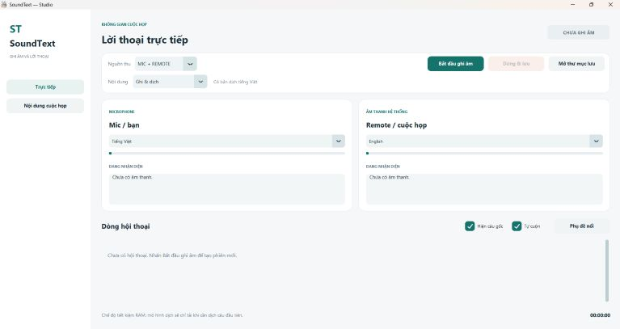
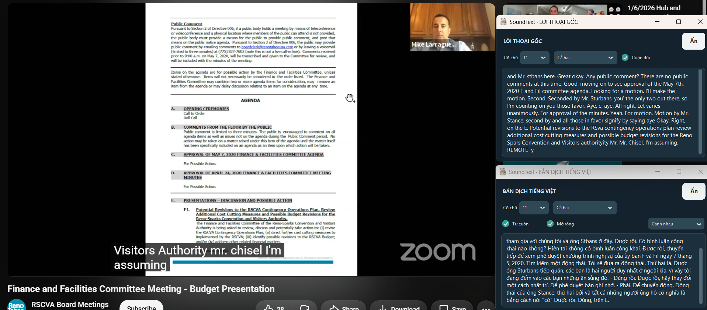
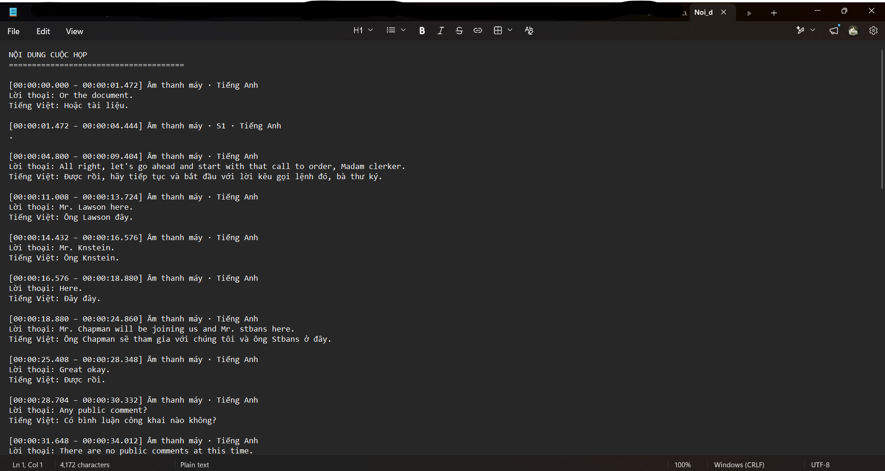

[Tiếng Việt](README.md) | [English](README_EN.md)

# SoundText

**Real-time speech transcription and translation for Windows.**

SoundText is a desktop application that captures speech from your microphone, your computer's audio, or both. It displays transcripts as you listen, can translate Japanese and English into Vietnamese, and saves a readable transcript at the end of each session.

I started building SoundText for a fairly simple reason: I wanted to follow meetings, videos, and lectures without constantly switching between a media player and a translation tool. The goal is to make those tasks easier to handle in one place, directly on your computer, with a straightforward interface and no GPU requirement.





## Features

- **Flexible audio capture:** Choose your microphone (MIC), computer audio (REMOTE), or both. Recording starts only when you click **Start Recording**.
- **Vietnamese, Japanese, and English speech recognition:** Follow the transcript while the application is running, with automatic Japanese/English language detection available.
- **Transcription with or without translation:** Choose **Transcription Only** when you don't need translation, or **Transcribe & Translate** to translate Japanese/English speech into Vietnamese.
- **Two independent floating subtitle windows:** Show the original transcript and Vietnamese translation in separate windows. Open only the one you need, move it wherever you like, and adjust the font size.
- **Speaker identification for REMOTE audio:** Assign speaker labels when there is enough information to do so. Speaker diarization is not applied to microphone audio.
- **Readable session transcripts:** Export `Noi_dung/Noi_dung_cuoc_hop.txt` with timestamps, audio sources, original speech, and translations when available. Technical files are retained for troubleshooting.
- **Customizable application branding:** Edit `branding.json` to change the display name, icon, and splash screen.

SoundText is designed for taking meeting notes, following Japanese or English videos and lessons, and keeping a record of conversations you may want to revisit later.

## How does it work?

Once the models have been downloaded, SoundText runs speech recognition and translation **locally on your computer**. You don't need to send meeting audio to an online speech recognition service to use these features.

Local processing comes with trade-offs. Performance depends on your CPU and available RAM, and background noise, overlapping speakers, or very short utterances can affect accuracy. On a machine with 8 GB of RAM, it's best to start with a single audio source in transcription-only mode before enabling translation.

## System requirements

| Component | Requirement / recommendation |
| --- | --- |
| Operating system | Windows 10/11, 64-bit |
| Python | Python 3.11 (64-bit) recommended for running from source and building the EXE |
| Hardware | x64 CPU; a GPU is not required |
| Memory | 8 GB can be used with memory-saving settings; more RAM is preferable when translation is enabled |
| Audio | A microphone or a Windows audio device that supports loopback capture |

## Run from source

### 1. Set up the environment

Open Miniconda Prompt in the project directory:

```bat
conda create -n soundtext python=3.11 -y
conda activate soundtext
python -m pip install -r requirements.txt
```

### 2. Prepare the models

Run `SoundText.bat` and select the relevant options:

| Option | Purpose |
| --- | --- |
| `8` | Download speech recognition models: Gipformer, SenseVoice, and Silero VAD |
| `9` | Prepare the speaker diarization models |
| `10` | Prepare the NLLB ONNX translation model |
| `4` | Check installed models and dependencies |
| `1` | Launch SoundText |

Models are not included with the source code. Once downloaded, they are stored in the `models/` directory.

### 3. Start using SoundText

Launch the application menu:

```bat
SoundText.bat
```

Select `1`. When the interface appears, choose an audio source, languages, and content mode, then click **Start Recording**. To finish a session, click **Stop & Save**.

The **Open Output Folder** button takes you to the readable TXT transcript. Logs, JSON files, and other data used for recovery or debugging are kept separately.

*Note: Button names above are English descriptions; labels in the current application interface may appear in Vietnamese.*

## Technologies used

| Component | Role |
| --- | --- |
| CustomTkinter | Desktop interface |
| Gipformer | Vietnamese speech recognition |
| SenseVoice / FunASR | Japanese and English speech recognition |
| Silero VAD | Voice activity detection |
| NLLB ONNX | Japanese/English-to-Vietnamese translation |
| ONNX speaker models | Speaker labeling for REMOTE audio |
| PyAudioWPatch / WASAPI loopback | Microphone and system audio capture |
| PyInstaller | Packaging the portable Windows application |

## Build the Windows EXE

SoundText uses PyInstaller in **one-folder** mode: the executable and its dependencies live together in a distribution directory, while model files remain outside the EXE so they can be updated independently.

With Python 3.11 and the project dependencies installed, run:

```bat
python -m pip install -r requirements-exe.txt
.\scripts\build_windows_exe.bat
```

The expected output is in `dist\SoundText\`. Copy your downloaded models to `dist\SoundText\models\`, then launch `dist\SoundText\SoundText.exe`.

**When distributing the app, keep the entire `dist\SoundText\` directory together. Copying only the `.exe` will not work.**

## Project structure

```text
SoundText/
├── main.py                        # Python entry point
├── SoundText.bat                  # Launcher and setup menu
├── branding.default.json         # Default app name, icon, and splash configuration
├── config_stt_vi_ja.default.json  # Default audio and recognition configuration
├── app/                           # UI, audio, ASR, translation, and data storage
├── scripts/                       # Model preparation and EXE build tools
├── models/                        # Downloaded models (do not commit to Git)
└── output/                        # Transcripts and logs
```

After the first run, edit `branding.json` to change the app's display name and images. The icon and metadata embedded in the EXE itself must be set before building.

## Privacy and limitations

SoundText processes audio locally after the required models have been prepared. An internet connection may be needed during installation or model downloads. Session data is saved under `output/`; check it before sharing logs or committing files to a repository.

Speech recognition, translation, and speaker identification are not always accurate, especially when multiple people speak at the same time. Larger models can also use substantial amounts of memory. On an 8 GB Windows machine, test the EXE carefully before enabling multiple audio sources and translation together.

If you plan to distribute SoundText together with its models, review the licenses of each model and its related libraries.

## Contributing and reporting issues

If you encounter a problem, feel free to open an Issue with your SoundText version, Windows/Python versions, steps to reproduce the issue, and any relevant logs. Please remove personal information and meeting content before posting logs publicly.

Feedback and contributions that make SoundText more reliable, easier to use, or more compatible with different Windows systems are welcome.

Contact: nhatvipmason@gmail.com
